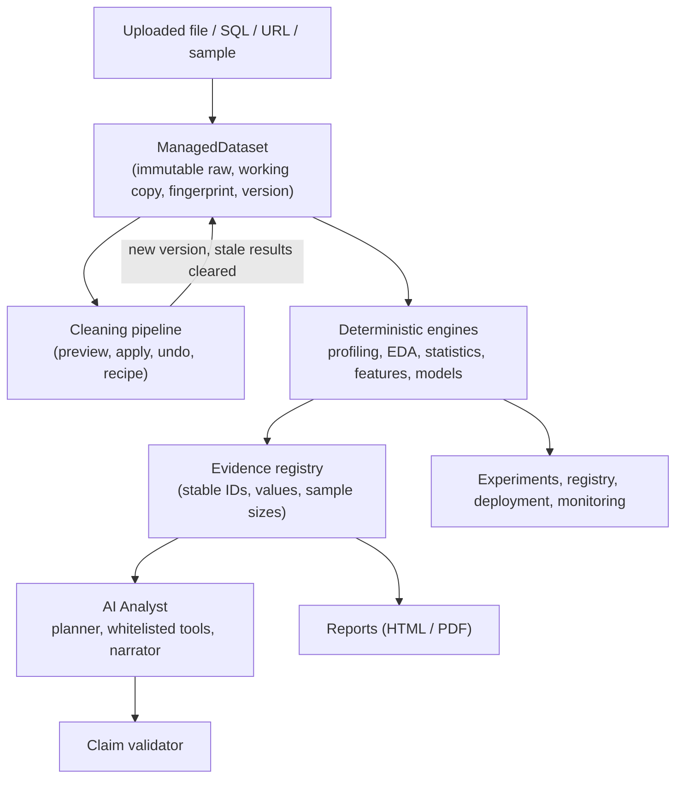

# CelestiusAI: Data Analyst and Data Scientist

**An AI-assisted analytics and machine-learning workspace that takes you from a raw file to validated insights, tested models, and a deployed prediction service, with the Python for every step.**

CelestiusAI pairs two roles in one Streamlit application:

- **Data Analyst:** ingest, audit, clean, document, explore, visualize, and report.
- **Data Scientist:** test hypotheses, engineer features, build and compare models, explain them, and run them in production.

An **AI Analyst** sits on top: it plans multi-step investigations and explains results in plain English, but it never computes anything itself. Deterministic engines (pandas, SciPy, statsmodels, scikit-learn) produce every number, and every claim the AI makes is checked against that computed evidence.

---

## Contents

1. [Highlights](#highlights)
2. [Quickstart](#quickstart)
3. [A 10-minute guided tour](#a-10-minute-guided-tour)
4. [Workspaces and features](#workspaces-and-features)
5. [The AI Analyst and LLM providers](#the-ai-analyst-and-llm-providers)
6. [View code: reproduce anything in Colab or Jupyter](#view-code-reproduce-anything-in-colab-or-jupyter)
7. [Sample datasets](#sample-datasets)
8. [Configuration](#configuration)
9. [Architecture](#architecture)
10. [Security and privacy](#security-and-privacy)
11. [Testing and quality](#testing-and-quality)
12. [Docker](#docker)
13. [Troubleshooting](#troubleshooting)
14. [Known limitations](#known-limitations)

---

## Highlights

| | |
|---|---|
| **Evidence first** | Deterministic engines compute; the LLM only plans and narrates. Numeric claims are validated against evidence, with zero tolerance for invented figures. |
| **Works offline** | With no API key and no local model, every analysis, model, and report still works. The AI adds plain-English planning on top. |
| **Bring your own LLM** | Google Gemini, Anthropic Claude, or a local model through Ollama. Keys live in the session only, and PII can be redacted before any prompt leaves the app. |
| **Leakage-safe modeling** | Preprocessing is fitted inside each cross-validation fold; leakage suspects are flagged; baselines and nested CV keep scores honest. |
| **Broad model catalog** | 20+ regression, classification, and ensemble models (linear, tree, boosting, SVM, KNN, MLP, plus XGBoost, LightGBM, and CatBoost when installed). |
| **Code for every step** | A **`</> View code`** button turns analyses into standalone Python (also R and SQL for core steps) that you can customize, download as `.py` or `.ipynb`, and run in Colab. |
| **From data to deployment** | Experiment tracking, a versioned model registry with model cards, a FastAPI template, batch scoring checks, drift reports, and live monitoring. |
| **Reproducible and reversible** | Raw data is immutable; cleaning steps are previewed, undoable, saved as a recipe, and replayed when you reopen a project. |

---

## Quickstart

**Requirements:** Python 3.11 or newer.

```bash
# 1. Create and activate a virtual environment
python3 -m venv .venv
source .venv/bin/activate            # Windows: .venv\Scripts\activate

# 2. Install
pip install -r requirements.txt              # core app
pip install -r requirements-optional.txt     # optional: XGBoost, LightGBM, CatBoost, Optuna, SHAP, SQL, Claude

# 3. (Optional) configure AI providers
cp .env.example .env                 # then edit .env

# 4. Run
streamlit run app.py
```

Open <http://localhost:8501>. No dataset yet? Click **Try sample data** on Home, or pick one of the 10 bundled datasets on the Executive Overview.

> **After pulling code changes, restart `streamlit run`.** Streamlit keeps imported modules in memory, so a stale server can raise import errors for new helpers.

### Install options at a glance

| File | Purpose |
|---|---|
| `requirements.txt` | Everything needed to run the app (Gemini SDK included). |
| `requirements-optional.txt` | Extra model families, Optuna, SHAP, SQL connectors, Claude. Each is detected at runtime and skipped if missing. |
| `requirements-dev.txt` | Optional packages plus pytest, ruff, and the libraries the tests use to run generated code. |
| `pyproject.toml` | Same dependencies as extras: `pip install -e ".[ml,sql,claude,dev]"`. |

---

## A 10-minute guided tour

1. **Load data.** On **Executive Overview**, drop a CSV/Excel/Parquet file into the search-bar-style uploader, or load a sample dataset.
2. **Audit quality.** Open **Data Quality**: review the 0-100 quality score, preview each suggested fix, apply it, and undo if you disagree. Export the cleaning recipe.
3. **Understand the data.** **Exploration Studio** shows distributions, correlations, and segment differences; **Data Dictionary** documents every column.
4. **Test a hypothesis.** **Statistical Intelligence** runs t-tests, ANOVA, chi-square, correlation, and OLS with assumption checks, effect sizes, and a plain-English takeaway.
5. **Build a model.** In **Model Lab**, use **AutoML** for a one-click pipeline, or **Train & evaluate**, **Selection & race**, **Ensembles**, and **Tuning** for control.
6. **Explain it.** **Model Explainer** gives global importance, partial dependence, what-if scenarios, fairness, and drift checks.
7. **Ship it.** **MLOps** logs runs, registers versioned models with model cards, serves them with a FastAPI template, and monitors live performance.
8. **Ask and report.** Ask the **AI Analyst** questions in plain English, then export an HTML or PDF dossier from **Intelligence Reports**.

At any step, click **`</> View code`** to get the Python behind what you see.

---

## Workspaces and features

Navigation is grouped into six sections. Larger pages contain switchable sections (a radio at the top), so only the section you are viewing runs.

### Start

| Page | What it does |
|---|---|
| **Home** | Project overview, quick access, featured workspaces, current dataset panel, workflow guide, and FAQ. |
| **Executive Overview** | Search-bar-style upload (CSV, Excel, Parquet), 10 bundled sample datasets, a one-screen briefing with grounded findings, and recommended next steps. |

### Data Analyst

| Page | Capabilities |
|---|---|
| **Data Quality** | Schema inference and semantic types; missing values and placeholder tokens; exact duplicates and key conflicts; outliers (IQR, Z-score, MAD); consistency checks; a transparent multi-dimensional quality score; a cleaning workbench with dry-run previews, undo, reset, and a replayable recipe. |
| **Data Dictionary** | Auto-generated column documentation: types, ranges, categories, descriptions you can edit, and export. |
| **Data Sources** | Beyond file upload: read-only SQL, URL, and Google Sheets sources with safe-query guards. |
| **Transformation Studio** | Joins, pivots, and reshaping with previews; results register as the active dataset. |
| **Exploration Studio** | Univariate and bivariate views, correlations, grouped and temporal analysis, an automated chart recommender, and grounded interpretation. |
| **Dashboard Builder** | 17 tile types (KPIs with trends, gauges, combo, funnel, map, and more), sections, resizable tiles, themes, colour-blind-safe palettes, cross-filtering, drill-down, parameters, calculated fields; export to HTML, Excel, or PDF; AI-assisted layout; generate a standalone Streamlit app. |

### Data Scientist

| Page | Sections and capabilities |
|---|---|
| **Statistical Intelligence** | *Hypothesis tests:* two-group, paired, multi-group ANOVA, chi-square, correlation, multiple-testing correction, robustness checks, OLS with diagnostics, plain-English takeaways. *A/B testing & power:* sample size, frequentist and Bayesian results, sample-ratio mismatch, a peeking simulator with corrected thresholds. |
| **Feature Lab** | *Engineering:* transforms, encodings, bins, dates, interactions, with leakage and identifier warnings and a reusable recipe. *Selection:* filter, wrapper (RFE), embedded, and stability selection; minimal feature sets; VIF and collinearity clusters; PCA compression; a voting summary that feeds the modeling pages. |
| **Unsupervised Lab** | K-means with elbow and silhouette, plain-English cluster profiles, PCA with loadings, isolation-forest anomalies. |
| **Time Series** | *Classical:* decomposition, stationarity tests, ACF/PACF, rolling-origin backtests against naive baselines, forecasts with ranges. *ML forecasting:* tree and linear models on lag and calendar features (direct or recursive), compared with naive baselines. |
| **Specialised Methods** | *Causal and uplift:* difference-in-differences with parallel-trends checks, propensity-score matching with balance diagnostics, uplift models with Qini curves. *Survival:* Kaplan-Meier, log-rank, Cox proportional hazards with checks and predicted curves. *Text:* TF-IDF classification with the top terms per class. |

### Modeling

| Page | Sections and capabilities |
|---|---|
| **Model Lab** | *Train & evaluate:* leakage-safe training, baselines, walk-forward validation, diagnostics, importance, prediction intervals. *AutoML:* leakage removal, model recommendation, race, tuning, stacking, 1-SE model choice, and a step-by-step report. *Selection & race:* a recommender based on your data's profile, cross-validated races, nested CV, corrected statistical comparison of models, learning and validation curves, model cards. *Ensembles:* bagging, voting, and stacking compared with their members, plus diversity analysis. *Tuning:* random, grid, successive-halving, or Bayesian (Optuna) search over any catalog model. |
| **Classification & Regression** | *Classification:* imbalance experiments (SMOTE and resampling inside the pipeline), threshold tuning, calibration, multi-class strategies. *Regression:* OLS diagnostics, GLMs (Poisson, Gamma, Tweedie), quantile regression and conformal bands, regularization paths, curvature and splines, target transforms, error analysis, Bayesian regression, bootstrap coefficients, power and sample size, mixed effects. |
| **Model Explainer** | Permutation importance, PDP/ICE, interaction strength, local explanations (Shapley, SHAP when installed), what-if and counterfactuals, fairness by group, and drift (PSI). |
| **MLOps** | *Experiments and registry:* run tracking, comparison, tags, notes, import and export, reproduction code; a versioned registry with stages (staging, production) and model cards. *Deployment and monitoring:* single-record and batch scoring with input validation, drift against training data, a FastAPI service template, `requirements.txt` for deployment, prediction logging, and live performance against real outcomes. |

### AI and reports

| Page | Capabilities |
|---|---|
| **AI Analyst** | Quick answers or multi-step investigations through a whitelisted tool registry, with an audit log and claim validation. |
| **Intelligence Reports** | Executive summary, methodology log, statistics, and model results exported as an interactive HTML dossier or a PDF. |

### Workspace

| Page | Capabilities |
|---|---|
| **Projects & Sessions** | Versioned projects: the cleaned data, the cleaning recipe (replayed on reopen), and the run history. |
| **Settings** | AI provider, model, and key (session-only), PII redaction, a sensitive-column scan with masking, and the tool audit log. |

---

## The AI Analyst and LLM providers

**Does it need an LLM?** No. Everything numeric is deterministic. The LLM adds planning and narration; without one the app falls back to a rule-based planner.

| Provider | Setup | Notes |
|---|---|---|
| **Google Gemini** | Set `GEMINI_API_KEY` in `.env`, or paste it on **Settings** | Key pasted on Settings lasts for the session only. Model set with `GEMINI_MODEL`. |
| **Anthropic Claude** | `pip install anthropic`, then `ANTHROPIC_API_KEY` or Settings | Choose the model on Settings. |
| **Ollama (local)** | Install Ollama, `ollama serve`, `ollama pull llama3.1` | Default host `http://localhost:11434`. No key; data never leaves your machine. Settings checks connectivity. |
| **Offline** | Nothing | Rule-based planner; all analysis still works. |

**How answers stay trustworthy**

1. The planner may call only approved analytical tools (no `eval`, shell, or raw SQL).
2. Each tool returns structured **evidence** with stable IDs, values, and sample sizes.
3. The narrator writes from that evidence, and a **numerical claim validator** rejects statements that do not match.
4. Observational data is described with associations, never as proven causes.

---

## View code: reproduce anything in Colab or Jupyter

Most components have a **`</> View code`** popover with standalone Python (pandas, scikit-learn, statsmodels, Plotly) that reproduces what you see.

- **Customize the code:** chart library (Plotly, Matplotlib, Seaborn), comment level (none, brief, teaching), sanity checks, notebook or function layout, data source (local file, Colab upload, Google Drive, URL, Google Sheet), theme, palette, titles, and size.
- **Export:** download as `.py` or `.ipynb`, copy a single **Colab cell**, or use the sidebar to export every snippet on the page as one notebook.
- **Other languages:** R (tidyverse) and SQL equivalents for core components.
- The test suite executes the generated code and compares its output with the app's engine, so snippets stay correct.

---

## Sample datasets

Ten ready-made datasets (plus the original e-commerce churn file) live in `sample_data/` and load from the Executive Overview gallery. They include realistic problems: missing values, outliers, imbalance, messy casing.

| Dataset | Good for |
|---|---|
| `hr_attrition` | Classification, survival analysis |
| `house_prices` | Regression, outliers |
| `retail_sales_daily` | Time series, forecasting |
| `marketing_ab_test` | A/B testing, causal analysis |
| `credit_default` | Imbalanced classification |
| `patient_readmission` | Data quality, classification |
| `iot_sensor_readings` | Anomalies, time series |
| `product_reviews` | Text classification |
| `student_performance` | Regression, group tests |
| `airline_delays` | Regression, data cleaning |
| `ecommerce_customer_churn` | Quality audit, churn modeling |

Regenerate the ten synthetic files with `python scripts/make_sample_data.py` (deterministic).

---

## Configuration

Copy `.env.example` to `.env`. Everything is optional.

| Variable | Default | Meaning |
|---|---|---|
| `APP_NAME` | `CelestiusAI` | Name shown in the UI and reports. |
| `APP_ENV` | `development` | Environment label. |
| `LOG_LEVEL` | `INFO` | Logging verbosity. |
| `MAX_UPLOAD_SIZE_MB` | `100` | Upload limit. |
| `AGENT_MAX_ITERATIONS` | `10` | Cap on investigation steps. |
| `AGENT_EXECUTION_TIMEOUT_SECONDS` | `120` | Time cap for agent runs. |
| `LLM_PROVIDER` | `gemini` | Default provider (providers can also be switched in Settings). |
| `GEMINI_API_KEY`, `GEMINI_MODEL` | unset | Gemini credentials and model. |
| `ANTHROPIC_API_KEY`, `ANTHROPIC_MODEL` | unset | Claude credentials and model. |
| `OLLAMA_HOST`, `OLLAMA_MODEL` | `http://localhost:11434`, `llama3.1` | Local model server and model. |
| `LLM_TIMEOUT_SECONDS`, `LLM_MAX_RETRIES` | `60`, `2` | Provider call limits. |

Theme and server defaults are in `.streamlit/config.toml`.

---

## Architecture



### Repository layout

```text
CelestiusAI/
├── app.py                      # Navigation router (st.navigation, grouped sections)
├── pages/                      # One file per workspace; large pages host switchable sections
├── src/
│   ├── sections/               # Section bodies shown inside parent pages
│   ├── config/                 # Typed settings, secret masking
│   ├── core/                   # Session state, UI components, code generators, site content
│   ├── ingestion/              # Loaders, schema inference, cleaning pipeline, recipes, samples
│   ├── profiling/              # Missingness, duplicates, outliers, quality score
│   ├── analytics/              # Statistical and exploratory engines
│   ├── interpretation/         # Grounded narrative layers, contradiction detection
│   ├── datascience/            # Model catalog, selection, ensembles, regression, features,
│   │                           #   explainability, tracking, AutoML, causal, survival, text, time series
│   ├── predictive/             # Leakage-safe predictive lab engine
│   ├── agent/                  # Planner, tool registry, providers (Gemini, Claude, Ollama)
│   ├── reporting/              # HTML and PDF dossiers
│   ├── visualization/          # Chart builders
│   ├── security/               # Privacy: PII redaction, sensitive-column scan
│   └── workspace/              # Projects and the model registry
├── sample_data/                # 11 bundled datasets
├── scripts/                    # make_sample_data.py
├── tests/                      # Engine, code-generator, and AppTest page tests
├── artifacts/                  # Local projects, registry, and exports (git-ignored)
├── .github/workflows/ci.yml    # Ruff and pytest on Python 3.11 and 3.12
├── Dockerfile
├── requirements*.txt, pyproject.toml, .env.example
└── README.md
```

### Design principles

- **Tool-first:** every number comes from tested deterministic code.
- **Engines are separate from UI:** `src/` modules are pure and unit-tested; pages are thin.
- **Dataset lifecycle:** cleaning increments a dataset version, clears stale downstream results, and marks previously trained models stale.
- **Generated code is tested:** each code generator is executed in tests and compared with its engine.

---

## Security and privacy

- **Keys are session-only:** never written to disk or logs; configuration values are masked in diagnostics.
- **PII controls:** optional redaction before prompts leave the app, a sensitive-column scan, and masking.
- **No arbitrary execution:** the AI can call only registered analytical tools; no `eval`, shell, or free-form SQL. Data-source SQL is read-only and guarded.
- **Prompt-injection screening** of user prompts and intermediate inputs.
- **Upload hardening:** filename sanitization, extension allowlists, size limits, content fingerprints.
- **Model files are pickles:** `.joblib` exports and registry files are Python pickles. **Only load files you created or fully trust.**
- **Local data:** saved projects and the registry live under `artifacts/` on your machine and are git-ignored.
- **Local models:** with Ollama, no data leaves your machine.

---

## Testing and quality

```bash
pip install -r requirements-dev.txt
pytest                      # ~880 tests: engines, code generators, and Streamlit AppTest page flows
ruff check .                # lint
ruff format --check .       # formatting
```

Tests cover each engine against synthetic data with known ground truth (recovered coefficients, conformal coverage, covariate balance, sample-size formulas), execute generated code, and drive pages end to end. CI runs ruff and pytest on Python 3.11 and 3.12.

---

## Docker

```bash
docker build -t celestiusai:latest .
docker run -p 8501:8501 --env-file .env celestiusai:latest
```

The image uses `python:3.12-slim`, runs as a non-root user, and includes a health check on `/_stcore/health`. Install optional packages in the image by adding `requirements-optional.txt` to the Dockerfile if you need XGBoost, SHAP, SQL connectors, or Claude.

---

## Troubleshooting

| Symptom | Fix |
|---|---|
| `ImportError` for a new helper after updating | Restart `streamlit run`; Streamlit caches imported modules. |
| A model (XGBoost, LightGBM, CatBoost) is missing from lists | `pip install -r requirements-optional.txt`. |
| SHAP or Optuna options missing | Same: they are optional installs. |
| PDF export unavailable | The HTML export is always available; check that ReportLab and fonts are installed. |
| AI answers look rule-based | No provider is configured; add a key or start Ollama on **Settings**. |
| Ollama not detected | Run `ollama serve` and confirm the host (`OLLAMA_HOST`) and that a model is pulled. |
| Slow page | Use a smaller sample of rows on the heavy modeling sections, or lower CV folds and search trials. |

---

## Known limitations

1. **In-memory scale:** designed for single-node analysis (roughly up to a few hundred MB or about 2 million rows, depending on RAM). For larger data, extract a subset with an upstream engine (BigQuery, DuckDB, Spark).
2. **Single-user sessions:** Streamlit session state is per browser session. Multi-user deployments need an authentication proxy and a database-backed store.
3. **Observational data:** the app uses associative language and offers causal tools (matching, difference-in-differences) with explicit warnings; they reduce but cannot remove bias from unmeasured confounders.
4. **Local registry:** the model registry and projects are file-based on one machine; it is not a shared team registry.
